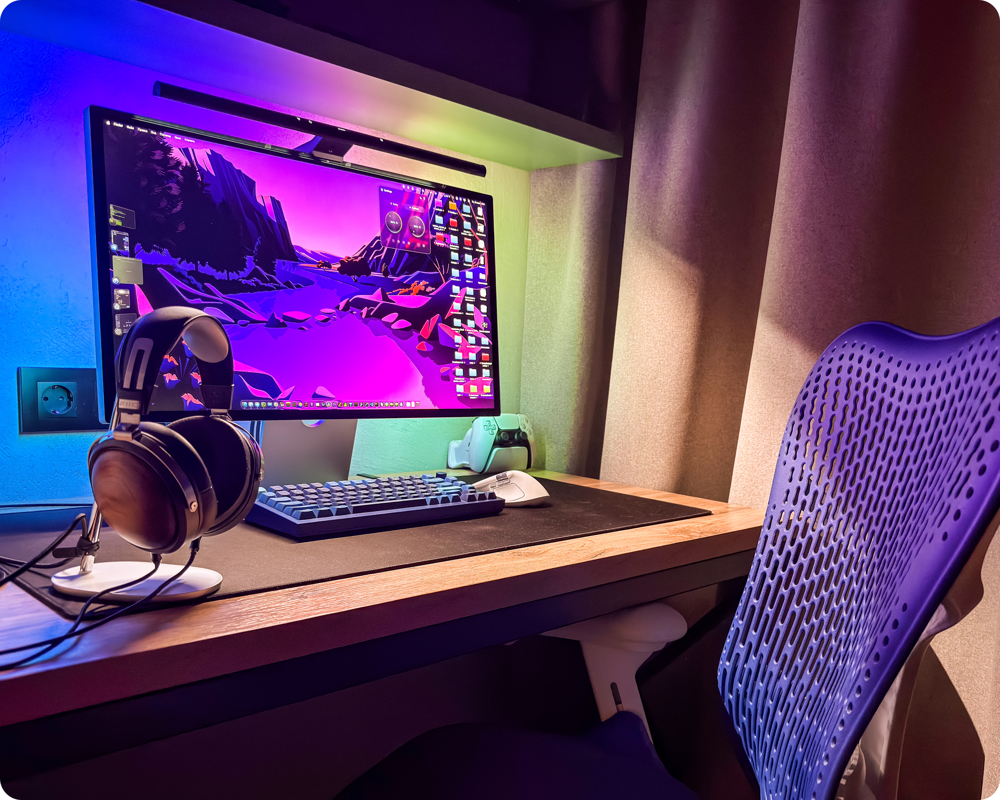
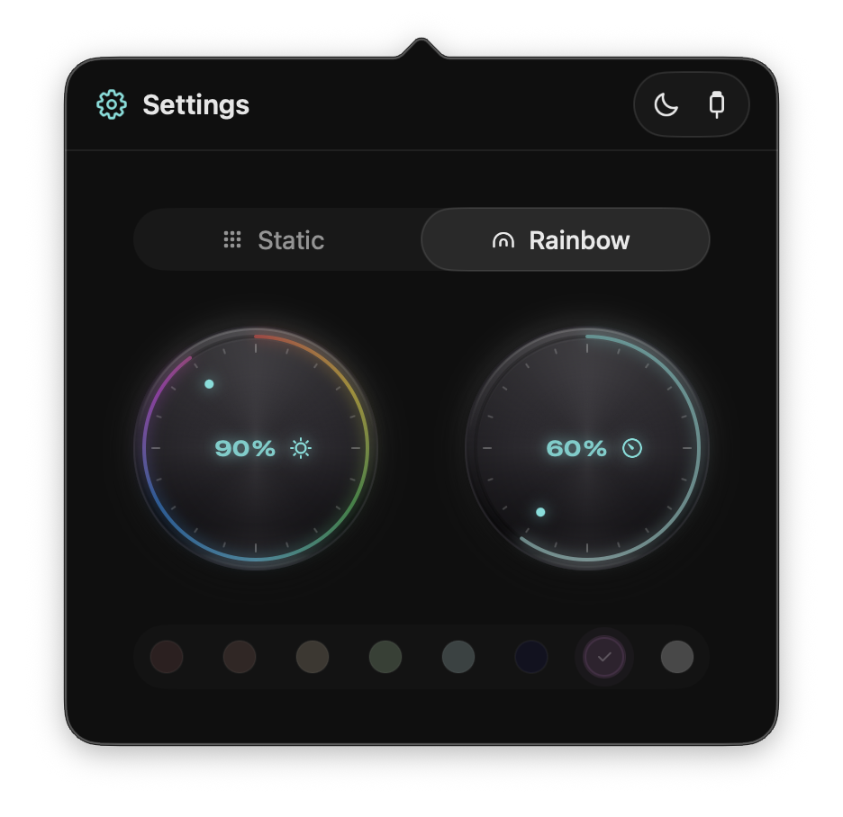

<div align="center">

# Cylch

### Ambient light, beautifully controlled from your Mac.

A native macOS menu bar app for driving Adalight-compatible LED strips over USB serial — with fluid controls, thoughtful automation, and a delightfully small footprint.

<p>
  
  
  
  
</p>

</div>

<div align="center">
  
</div>

## Light that stays out of your way

Cylch lives in the menu bar and turns a compatible LED setup into a natural part of macOS. Connect your controller, choose an effect, and shape the atmosphere without opening a heavy desktop app.

<p align="center">
  
</p>

## Highlights

- **Native menu bar experience** — the controls you need, always one click away.
- **Rainbow and static modes** — animated color or a curated solid-color palette.
- **Live brightness and speed control** — responsive adjustments while streaming.
- **Automatic serial discovery** — supports common USB serial names including FTDI, CH340/CH341, CP210x, USB modem, and WCH devices.
- **Configurable LED count** — drive strips from 1 to 300 LEDs.
- **Night schedule** — automatically switch lighting off during chosen quiet hours.
- **Smooth transitions** — gentle fades on connect, disconnect, effect changes, and scheduled shutoff.
- **Reconnect and persistence** — remembers the selected port, effect, color, levels, schedule, and connection preference.
- **Launch at Login** — start Cylch alongside your Mac.

## How it works

```text
 Cylch for macOS  ── USB serial / Adalight ──▶  LED controller  ──▶  LED strip
```

Cylch generates color frames locally and streams them directly to the selected serial device using the Adalight protocol. No lighting cloud or account is required for device control.

## Requirements

- macOS 15.0 or later
- Xcode with macOS development support
- An Adalight-compatible controller connected over USB serial
- A supported addressable LED strip configured on that controller

## Build from source

1. Clone the repository:

   ```bash
   git clone https://github.com/jareksedy/Cylch.git
   cd Cylch
   ```

2. Open `Cylch.xcodeproj` in Xcode.
3. Let Xcode resolve the Swift Package dependencies.
4. Select the **Cylch** scheme and run the app.
5. Choose your serial port and LED count from the connection panel.

> [!NOTE]
> Cylch uses Firebase Analytics. If you build your own fork, provide a valid `GoogleService-Info.plist` for your Firebase project or remove the analytics integration.

## Controls

| Control | What it does |
| :--- | :--- |
| **Static / Rainbow** | Switches between a solid color and an animated spectrum |
| **Brightness** | Sets the output intensity from 0–100% |
| **Speed** | Changes the Rainbow animation speed |
| **Color palette** | Selects a color while Static mode is active |
| **Connection** | Chooses the serial port, LED count, and connection state |
| **Night Schedule** | Defines the daily interval when LEDs stay off |

## Built with

- Swift & SwiftUI
- AppKit menu bar APIs
- Darwin serial I/O
- ServiceManagement
- Firebase Analytics

## Contributing

Ideas, bug reports, and pull requests are welcome. If you are planning a larger change, open an issue first so the approach can be discussed.

---

<div align="center">
  <sub>Made for calmer desks and brighter ideas.</sub>
</div>
